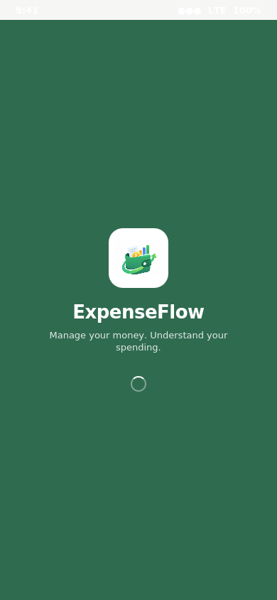
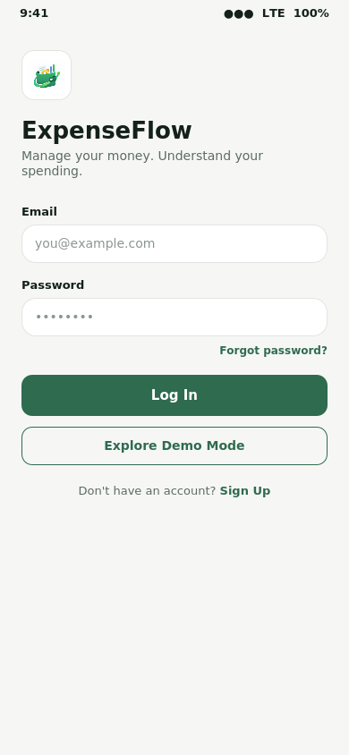
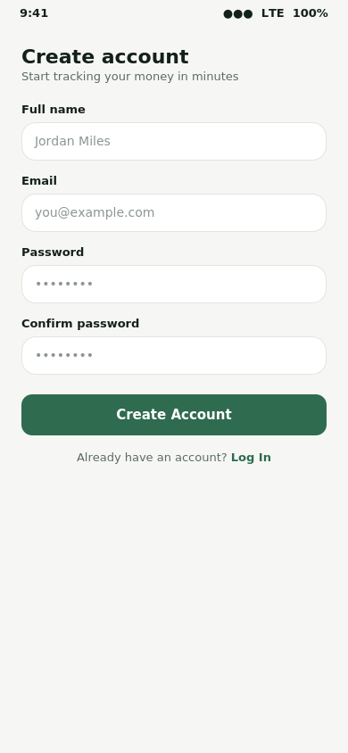
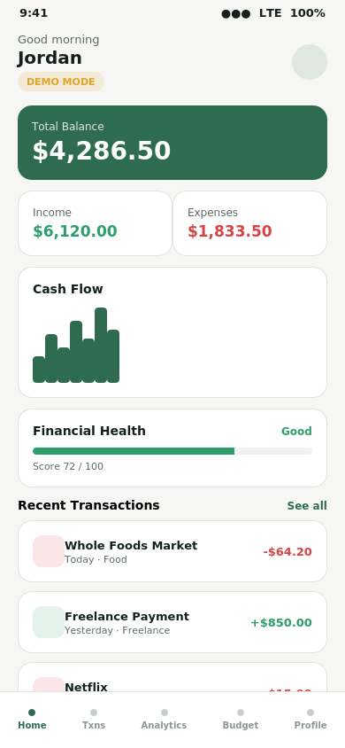
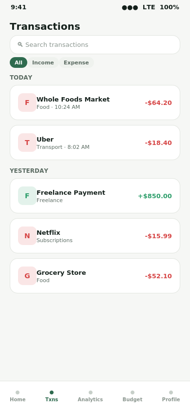
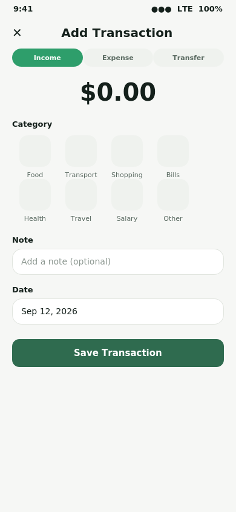
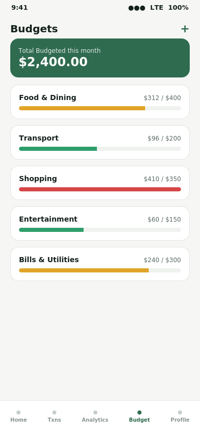
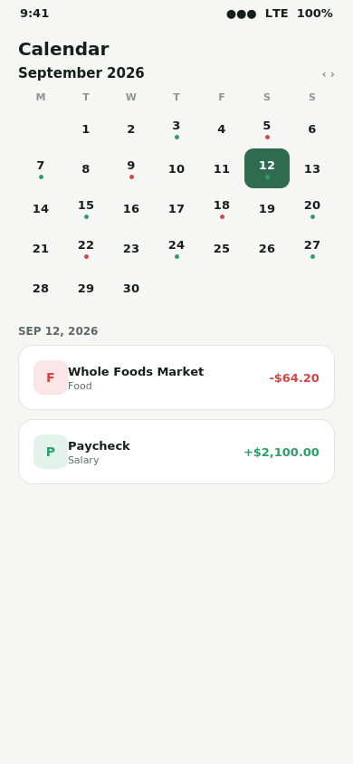
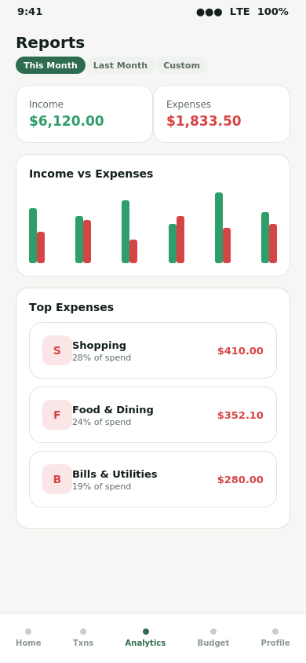
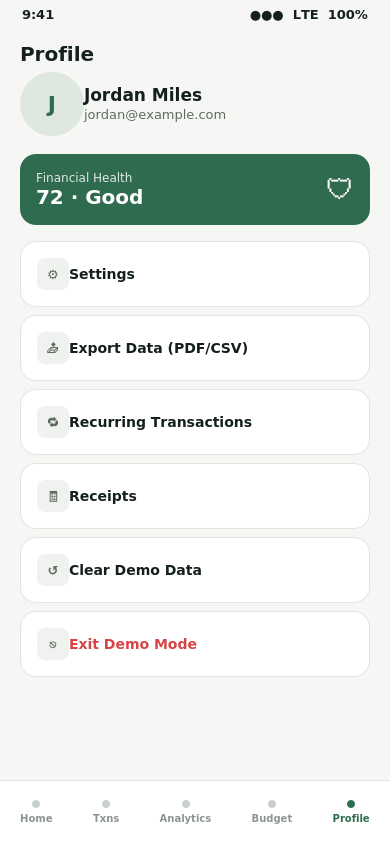

<p align="center">
  
</p>

<h1 align="center">ExpenseFlow</h1>

<p align="center">
  A modern personal finance & expense tracking app built with Flutter,
  Riverpod, GoRouter, Firebase, and fl_chart.
</p>

---

## Overview

ExpenseFlow helps you track income and expenses, set budgets, review
spending trends, and get a deterministic "Financial Health Score" —
all from real transaction data, nothing hardcoded. It runs in two modes:

- **Demo Mode** — fully local, no sign-up, seeded with realistic data.
  Great for trying the app or for grading/demo purposes.
- **Authenticated Mode** — Firebase Auth + Firestore, data synced per
  user across devices.

## Screenshots

| | |
|---|---|
|  <br> **Splash Screen** |  <br> **Login** |
|  <br> **Register** |  <br> **Dashboard** |
|  <br> **Transactions** |  <br> **Add Transaction** |
|  <br> **Budgets** |  <br> **Financial Calendar** |
|  <br> **Reports & Analytics** |  <br> **Profile** |

> These renders are built directly from the app's real design system —
> the same colors, spacing, and layout defined in `core/theme/` — so
> they're an accurate preview of each screen. If your submission needs
> literal device screenshots, run the app (see below) and replace the
> files in `/screenshots` with your own captures; the README will pick
> them up automatically since the filenames stay the same.

## What's implemented

- **Two modes**: Authenticated (Firebase Auth + Firestore) and Demo Mode
  (fully local, no login, seeded with ~4 months of realistic data).
- **Feature-based clean architecture**: `models/ → services/ →
  repositories/ → providers/ → features/`. UI never talks to Firebase
  or SharedPreferences directly.
- **Dashboard** with real calculated totals, cash-flow chart, category
  breakdown, budget snapshot, financial health score, upcoming bills,
  and recent transactions.
- **Transactions**: add / edit / delete / duplicate, search, filter,
  sort, swipe-to-delete with confirmation.
- **Budgets**: overall + per-category, with 70/90/100% warning tiers,
  computed live from actual transactions.
- **Recurring payments** with daily/weekly/monthly/yearly frequency and
  an "upcoming in 14 days" feed.
- **Financial Calendar** with income/expense day markers.
- **Analytics**: income vs. expenses, category distribution, budget
  utilization, savings trend — all fl_chart, all derived from data.
- **Financial Health Score**: fully deterministic, rule-based (see
  `core/utils/financial_health_calculator.dart`) — explicitly NOT an AI
  feature, and every input/weight is inspectable in code.
- **Reports**: monthly PDF and CSV export, current/previous/custom range.
- **Multi-currency** (BDT/USD/EUR/GBP/INR) display formatting via `intl`.
- **Profile & Settings**: theme (light/dark/system), currency,
  notifications toggle, start-of-week, data export, clear demo data,
  logout.
- **Firestore & Storage security rules** (`firestore.rules`,
  `storage.rules`) enforcing per-user data isolation.
- Loading skeletons, empty states, and error states with retry on every
  data screen.

## Tech stack

| Layer | Choice |
|---|---|
| Framework | Flutter (Dart) |
| State management | flutter_riverpod |
| Navigation | go_router |
| Backend (Authenticated Mode) | Firebase Auth, Cloud Firestore, Firebase Storage |
| Local persistence (Demo Mode + settings) | shared_preferences |
| Charts | fl_chart |
| Export | pdf, printing, csv |

## Storage — how data is saved

- **Demo Mode** → everything (transactions, budgets, recurring items,
  categories, settings) is JSON-encoded and saved locally on-device via
  `shared_preferences`. It never touches Firestore.
- **Authenticated Mode** → data is written to Cloud Firestore under the
  signed-in user's UID, so it syncs across devices. App settings are
  still cached locally for fast startup.

See `lib/services/local_storage_service.dart` and
`lib/services/firestore_service.dart` for the implementation.

## Getting started

This repo already includes the Android/iOS/web/desktop platform
folders, so no `flutter create` step is needed.

```bash
# 1. Fetch packages
flutter pub get

# 2. Wire up your own Firebase project (creates lib/firebase_options.dart)
dart pub global activate flutterfire_cli
flutterfire configure

# 3. Deploy security rules to your Firebase project (optional but recommended)
firebase deploy --only firestore:rules,storage:rules

# 4. Run it
flutter run  
```

**Demo Mode works immediately without any of the above** — the app is
usable end-to-end on first launch via "Explore Demo" even before
Firebase is wired up. Authenticated Mode requires steps 2–3.

To build an installable Android APK instead of running in debug mode:

```bash
flutter build apk --release
# output: build/app/outputs/flutter-apk/app-release.apk
```

## Architecture map

```
lib/
  app/            MaterialApp.router, GoRouter config, bottom-nav shell
  core/           theme, constants, formatters, deterministic health calculator
  models/         immutable data classes (Transaction, Budget, Category, ...)
  services/       Firebase Auth/Firestore/Storage wrappers, local storage, exports
  repositories/   route demo-vs-authenticated persistence, hide that branch from UI
  providers/      Riverpod state — session, transactions, budgets, analytics
  features/       one folder per screen/flow
  widgets/        shared building blocks (cards, states, icons, app logo)
```

## Notes on the Financial Health Score

The score is a weighted sum of five deterministic sub-scores (savings
rate, budget usage, expense/income ratio, recurring payment burden,
month-over-month spending trend), each mapped from a real transaction
figure through an explicit lookup table — no machine learning, no
external API. Every input is visible in
`core/utils/financial_health_calculator.dart` and the weights live in
`core/constants/app_constants.dart`, so the number shown to the user
can always be explained.

## Branding

The app icon and in-app logo (splash screen, login screen) use the
artwork at `assets/images/logo.png`, registered via `pubspec.yaml` and
rendered through the shared `AppLogo` widget
(`lib/widgets/app_logo.dart`). Launcher icons for Android, iOS, and web
are generated from the same source image.
